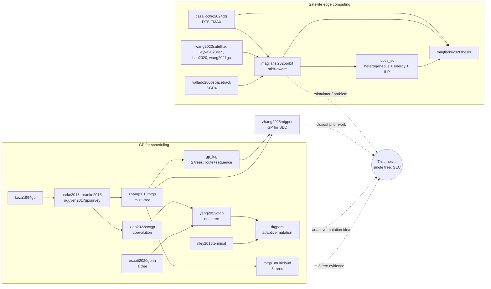

# Literature notes

Reading notes for `references.bib`, written 2026-10-21. They cover the six papers already in the bibliography and the references they led to. Every new BibTeX entry was checked against Crossref (DOI, authors, venue, pages) or against the paper itself.

## 1. What was read, and how

This was done in two passes. The first used open-access copies found on the web, because I had not yet opened your Google Drive folder. The second read the Drive folder, which contains all six original papers (including the two I could not get legitimately, the fog paper and the DTGPAM journal article), `GeneitProgrammingSEC.pdf` (which is the MTGPER paper) and your `Appunti` notes.

| Bib key | Paper | Where I read it | Coverage |
|---|---|---|---|
| `magliarisi2025orbit` | Magliarisi, Casalicchio, Salvatore (2025), *Orbit-aware task scheduling in SEC* | Open-access web version (CC BY). Springer blocks scripted downloads, so there is no local PDF | **Full text** |
| `icdcs_sc` | Magliarisi, Casalicchio, *Handling of energy- and time-constrained heterogeneous satellite computing services* | Drive: `IEEE_ICDCS_MCS.pdf`, plus Chapter 6 of `magliarisi2026thesis` | **Abstract, contributions, complexity and success-rate sections of the paper**; the rest via the thesis chapter. The PDF carries no author names |
| `koza1994gp` | Koza (1994) | Author's website, `papers/koza1994gp.pdf` (a Drive copy also exists) | **Full text** (35 pp.) |
| `mtgp_multicloud` | Sun et al. (2024) | Wellington repository, `papers/sun2024mtgp.pdf` (the Drive copy is the IEEE version) | **Full text** |
| `dtgpam` | Yang et al. (2025), journal article | Drive PDF, plus Chapter 3 of `yang2025thesis` | **Method: full, via the thesis chapter.** Journal article: contributions, parameter settings, results discussion and conclusions |
| `gp_fog` | Xu et al. (2023) | Drive PDF | **Abstract, contributions, method (representation and breeding), parameter and results discussion, conclusion.** Related work, simulator and the further-analysis sections were not read in detail |
| `zhang2025mtgper` | Zhang, Yang (2025), MTGPER | Drive: `GeneitProgrammingSEC.pdf` | **Full text** (figures and most of the reference list not inspected) |
| `zhang2018mtgp` | Zhang, Mei, Zhang (2018) | Author's homepage, `papers/zhang2018mtgp.pdf` | **Introduction, goals and conclusions** |
| `nguyen2017gpsurvey` | Nguyen, Mei, Zhang (2017) | Wellington repository, `papers/nguyen2017gpsurvey.pdf` | **Sections 3.3, 5.2 and the conclusions** |
| `magliarisi2026thesis` | Magliarisi (2026), PhD thesis, Sapienza | Open access | **Chapters 1 and 6**, abstract and publication list |
| `yang2025thesis` | Yang (2025), PhD thesis, Wellington | Open access | **Chapter 3** (DTGPAM) |

The open-access PDFs are in `thesis/papers/` and are gitignored, so they are not committed. The Drive PDFs were read through the Drive connector and are not copied into the repository. Your `Appunti` document confirms the same reading plan (MTGPER first, then Koza for GP basics, then the three GP-for-workflow papers) and its description of MTGPER matches the paper.

## 2. Summaries

### Satellite edge computing (SEC) scheduling

**`magliarisi2025orbit`**: *Orbit-aware task scheduling in SEC* (Cluster Computing 28, 2025)
- **Problem.** Ground-user tasks arrive at a LEO constellation. The scheduler must offload each task to a satellite edge node (SEN) and allocate resources there. The objective is the average response time, subject to deadline, memory and storage constraints (Eqs. 6–9).
- **Model.** Satellite motion comes from SGP4 and Starlink TLE data. A satellite counts as visible while its elevation is at least 40° (the "listening dome"), so each ground user has a "sunset time". Satellites have tens of neighbours within 659 km, not a four-neighbour grid. Each SEN is an M/M/1 non-preemptive priority queue with two priority classes.
- **Algorithms.** DTS-TMAX is decentralised: each SEN picks the feasible neighbour with the lowest response time, or propagates the search. OrbitAware additionally requires that the response time be shorter than the SEN's remaining visibility. Access points are chosen among satellites approaching the observer. A dynamic-priority scheme moves tasks between the two queue classes using waiting-time thresholds.
- **Evaluation.** SimPy discrete-event simulation, 40 satellites, 5 access points, service times of 10–50 s, a 600 s horizon, and a 20/80 high/low priority split. Dynamic priority beats static priority on success rate and mean response time. Fewer than 15% of requests finish after sunset under OrbitAware. DTS-TMAX and OrbitAware behave alike unless servers are overloaded.
- **Relevance to this thesis.** This is the problem, simulator and workload that `problem.tex` builds on. The paper deliberately uses fast heuristics rather than GA/optimisation, because satellite nodes cannot afford expensive decisions (its Related Work).

**`casalicchio2024dts`**: FMEC 2024. The precursor that introduced DTS-TMAX (cited as [15] in the journal paper). Not read; summarised from how the journal paper and the PhD thesis describe it.

**`icdcs_sc`**, read via `magliarisi2026thesis` Ch. 6
- **Extension.** It adds heterogeneous requests (generic, CPU-intensive, CPU-and-data-intensive, and data-intensive batch traffic), a per-SEN battery budget (a dynamic-voltage-scaling CPU energy model that grows with the cube of CPU frequency, plus 1 W transmission power), and result routing for the downlink.
- **Methods.** Distributed filter-and-select heuristics (minTime, OrbitAware, DTS variants) are compared with a weighted ILP and a hierarchical ILP (minimise time, then energy). The paper gives the heuristics O(n log n) per request (sorting n neighbours) against O(n^2.5) for the ILP, and explains why it chose heuristics: it prefers them to deep learning, genetic algorithms or optimisation because it needs a small performance footprint that scales with the constellation.
- **Results.** At λ = 10 req/s DTS-APopt and OrbitAware reach 76.5% and 75.7% success, against 34.7–37.2% for the two ILPs. The ILPs fail mostly on deadlines (79% of failures for the hierarchical ILP, 90.75% for the weighted one) because solving takes too long. The heuristics fail mostly on energy (about 61%). The ILPs give better load balancing and lower per-node energy, while the heuristics create hotspots around the access points. Heuristic selection costs O(|E|) or O(|E| log |E|). Greedy geometric routing beats B.A.T.M.A.N. on time, and B.A.T.M.A.N. finds shorter paths.
- **Agreement with the thesis.** Your sentence in `related_work.tex` (heuristics better on response time and success rate, ILP better on balancing and energy) matches this.
- **Inconsistencies.** The thesis calls the paper "submitted to ICDCS 2025", while a GitHub README cites "IEEE MASCOTS 2026". The thesis also lists two author sets for it. The venue and year are therefore still TODO in the bib.

**`magliarisi2026thesis`**: Sapienza PhD thesis (defended 11 May 2026) that bundles all of the above: the DTS framework, orbit-aware scheduling, the heterogeneous/energy chapter and a hybrid routing protocol. Its publication list also mentions an unpublished journal submission (*Offloading and resource allocation in SEC: long-running tasks performance analysis*, ICCK Journal of Systems Scalability). It is open access and the best single source on the simulator.

**Background cited by Magliarisi, added as context**
- `wang2023satellite`: vision and challenges of satellite computing.
- `leyva2023sec`: SEC for Earth observation.
- `han2020taskscheduling`: task scheduling on high-dynamic edge clusters.
- `wang2021ga`: genetic-algorithm computation offloading for multi-satellite tasks.
- `vallado2006spacetrack`: the SGP4 reference.

### Genetic programming for scheduling

**`koza1994gp`** is the founding paper. It frames problem solving as a search over programs, represented as trees of functions and terminals, and states the GP loop: random initial population, fitness evaluation, then reproduction and subtree crossover. Closure (every function must accept any value a terminal or function can return) and sufficiency are the preconditions, which is why protected division and similar operators exist. It also introduces automatically defined functions. Examples use populations of 500–10,000 and 51 generations.
- **Fit with this thesis.** `background.tex` cites it for the GP loop. Its closure requirement is the reason `method.tex` needs protected operators (an inference from the paper, not a claim the paper makes about this project).

**`nguyen2017gpsurvey`** is the main survey of GP hyper-heuristics for scheduling. Its unified framework has these components: meta-algorithm, component to evolve, representation, evaluation model, search mechanism and post-processing. Section 5.2 says there are two ways to evolve several decision rules at once: a richer representation holding multiple rules with custom operators, or cooperative coevolution of several subpopulations. It also advises against evolving every component, because search space and evaluation cost grow. The paper was read in part. It is the best citation for the choice between one tree and several.

**`zhang2018mtgp`** proposes multi-tree GP (MTGP) for dynamic flexible job shop scheduling, evolving a routing rule and a sequencing rule together. It adds a tree-swapping crossover (sMTGP) and compares against cooperative coevolution (CCGP). MTGP and sMTGP give better performance, smaller rules and shorter training than CCGP. This is the source of the MTGP and sMTGP names used in `related_work.tex`, which currently has no citation for them.

**`xiao2022cccgp`**: cooperative-coevolution GP hyper-heuristic for workflow scheduling. Cited by both Sun and Yang as the alternative to multi-tree. Not read.

### Cloud/fog workflow scheduling with GP

**`yang2025thesis` Ch. 3 / `dtgpam`**: DTGPAM
- **Individual.** Two trees, a VM selection rule (VMSR) and a task selection rule (TSR), evolved as one individual, for deadline-constrained dynamic workflow scheduling in the cloud.
- **Adaptive mutation.** Two levels. Tree level: a vector `ts = [p_both, p_vmsr, p_tsr]` is derived from a Beta distribution whose parameter α is adjusted by the 1/5 success rule on the mutation success ratio. Terminal level: terminal-weight vectors for each tree are estimated by maximum likelihood (convex optimisation with water-filling) from the best individuals, and a sampling ratio mixes them with uniform sampling.
- **Results.** Baselines are JIC-FCFS, HEFT-FCFS, plain DTGP and a frequency-weighted DTGP_f. DTGPAM gets the lowest mean cost in about half of 15 test scenarios and is significantly better mainly under loose deadlines (ξ = 12, 18, 24). Under tight deadlines (ξ = 1, 6) it is **not** significantly better than plain DTGP. It is insensitive to the initial α. Evolved rules are interpretable (VMR and LFT dominate the VM rules).
- **Journal article vs thesis.** The journal paper (Drive copy) has the same contributions and conclusions. Its GP settings are population 1024, 51 generations, one elite, tournament size 7, initial depth 2–6 and maximum depth 8. It reports the same pattern: significantly better under loose deadlines, not under the tightest ones.

**`gp_fog`**: Xu et al., *GP for dynamic workflow scheduling in fog computing*
- **Problem.** Workflows released by mobile devices can run on the device, an edge server or the cloud, all with limited resources. The objective is makespan. It proposes a new problem model, a new discrete-event simulator, and two decision points: routing (when a task is ready) and sequencing (when a processor is idle).
- **Method.** Multi-tree GP with two trees per individual (routing and sequencing). Both trees share one terminal set of ten terminals (queue length, queued work and so on). Initialisation is ramped half-and-half, selection is tournament, and breeding uses reproduction, subtree mutation and the tree-swapping crossover of `zhang2018mtgp`.
- **Results.** Nine scenarios of different scale (30 or 50 workflows, one to three mobile devices). The abstract claims makespan reductions of up to 50%, and the results text says the hand-designed baselines (HEFT and others) were two to three times worse. The paper counts seven baselines in one place and four in another.
- **Why it matters here.** It is the closest structural match to the routing and queuing split in SEC, and it is the source of the idea that the same terminals can feed both rules.

**`mtgp_multicloud`**: Sun et al.
- **Contribution.** Three trees per individual: task selection, cloud selection and instance selection. Rule priorities are minimised, so a lower value means higher precedence. There are 22 terminals in four groups (task, workflow, instance, cloud), the function set is {+, −, ×, protected ÷, max, min}, and the objective is total monetary cost under workflow deadlines.
- **Parameters.** Population 200, 50 generations, ramped half-and-half with depth 2–7, elitism 5, max depth 8, crossover 0.8, mutation 0.15, reproduction 0.05, tournament size 7, terminal selection rate 10%.
- **Results.** 30 runs per scenario, Friedman and Wilcoxon tests with Bonferroni correction. The 3-tree version beats the hand-designed baselines (DWS, REMSM, RMWS) on cost in every scenario, and beats the 2-tree variant in every Alibaba-trace scenario. In three of the four 20-workflow (scientific) scenarios, 3-tree and 2-tree are not significantly different. The decision time is under 0.02 s per decision point.
- **Why it matters here.** It is the clearest evidence that adding a decision tree helps only when the problem structure justifies it (an extra selection level), and that the gain grows with problem size.

**`escott2020gphh`, `yang2021budget`, `yang2022dtgp`, `riley2016terminal`, `topcuoglu2002heft`, `arabnejad2019dynamic`**: earlier single-tree GP for cloud workflows (Escott, Yang 2021), the conference version of DTGPAM (Yang 2022), the terminal-weighting and adaptive-mutation idea that DTGPAM generalises (Riley), the HEFT baseline, and a hand-designed dynamic multi-workflow baseline. Cited by Sun or Yang, not read.

### GP for SEC

**`zhang2025mtgper`**: Zhang and Yang, *MTGPER* (Future Generation Computer Systems 166, 2025), read in full
- **Problem.** Dynamic task scheduling in SEC. Tasks are randomly generated by ground devices (a non-homogeneous Poisson process), offloaded to a primary satellite and up to four neighbours, and the objective is the **task success rate** (fraction finishing before their deadline). There are two decision points: a routing rule that picks a satellite and a queuing rule that orders the satellite's buffer. Satellites are heterogeneous in speed, load and remaining energy, and a failed task is resubmitted.
- **Method.** Two trees per individual. Crossover does subtree crossover on one tree and swaps the whole other tree (the sMTGP idea). **Elite recombination** is the new part. The n elites in the Hall of Fame are combined in all n² ways, all n² combinations are evaluated, and the best n replace the Hall of Fame. A **behavioural repetition test** in the first 30 generations mutates individuals that rank servers and tasks identically on sample decisions, to keep the population diverse. Elite recombination then runs in generations 31–51. Your `Appunti` and `related_work.tex` describe this correctly.
- **Terminals and functions.** Eight terminals: NT (tasks in buffer), CL (computing load), RE (remaining energy), CC (computing capability), AT (arrival time), TS (task size), IDDL and RDDL (initial and remaining deadline). The paper says NT, CL, RE and CC make up the routing rule and AT, TS, IDDL and RDDL the queuing rule; its Table 2 also marks some terminals as shared, and its example evolved routing rule uses IDDL. Functions are +, −, ×, protected ÷, max, min.
- **Settings.** Population 200, 51 generations, ramped half-and-half with depth 1–3, maximum depth 7, crossover 0.8, mutation 0.15, reproduction 0.05, tournament size 2. Each individual's fitness is the mean over 100 simulation runs. 30 independent runs, tested on 30 unseen instances, in six scenarios ⟨simulation clock, arrival rate⟩.
- **Results.** Against eight hand-designed heuristics (FCFS, HEFT, EDF, MaxMin, MinMin, WMDC, MinTWK, MaxTWK) MTGPER is better in every scenario, for example 0.9374 against 0.9044 for the best baseline in ⟨100, 2.5⟩ and 0.9145 against 0.8388 in ⟨200, 3.5⟩. Against MTGP and sMTGP it is better in all six scenarios by mean, and significant in five of six. In ⟨200, 2.5⟩ the difference from MTGP is not significant. The gains over the other GP methods are small (mean success rate up by roughly 0.2 to 1.2 percentage points) and it runs slightly longer (mean runtime per run of about 5,500–18,000 s across scenarios, a few percent more than MTGP).
- **Interpretability.** The paper simplifies one evolved routing rule to roughly "fewest tasks, lowest load, highest capability" and one queuing rule to a mix of task size, remaining deadline and arrival time that combines LCFS, EDF and MinMin ideas.
- **Differences from this thesis's setting.** Its constellation is a Walker star with four neighbours and a 5° minimum elevation, and it has no satellite-visibility (sunset) constraint. This is exactly what Magliarisi et al. model and criticise, so the two papers do not share a model. The objective is success rate, not response time. It cites Yang's dual-tree paper (`yang2022dtgp`) as the "classical MTGP" and `zhang2018mtgp` as sMTGP.

**`zhang2026mtgpft`**: follow-up that adds a learned choice between task resubmission and replication for fault tolerance (abstract-level only; not read).

## 3. How the papers connect

Three threads tie the papers together.

1. **A single line of SEC work.** Casalicchio and Magliarisi (FMEC 2024) introduced decentralised scheduling. The Cluster Computing paper adds orbital motion and sunset, and the ICDCS-style paper adds heterogeneity, energy and an ILP comparison. The PhD thesis collects all three. Each step keeps the same decision structure, and every algorithm is a hand-written greedy filter-and-select rule.

2. **A single line of GP work.** Koza's tree GP became GP hyper-heuristics (Burke, Branke, Nguyen). For scheduling with more than one decision, there are two designs: multi-tree (Zhang 2018) and cooperative coevolution (Xiao 2022). Cloud workflow scheduling went from one tree (Escott) to two trees (Yang's DTGP, then DTGPAM; Xu's fog work with routing and sequencing) to three (Sun's multi-cloud work, adding cloud selection). Each added tree corresponds to a new decision point in the problem.

3. **The bridge.** `zhang2025mtgper` is the only paper I found that applies GP to SEC. It evolves routing and queuing rules, so it matches the two-rule structure in `related_work.tex`. It does not use the orbit-aware model: its constellation is a four-neighbour grid with no visibility window, which is the assumption Magliarisi et al. remove. Magliarisi's papers in turn mention GAs but not GP, and name small decision cost as the reason for choosing heuristics. This thesis sits between the two: a GP priority function over (task, satellite) pairs, on top of the Magliarisi simulator and its orbit-aware model.

## 4. What this suggests for the thesis

1. **Justify "single tree" with evidence.** Nguyen §5.2 and Sun's 2D/3D comparison are the strongest citations. Sun found the extra tree gave no significant gain on the smallest scenarios and a clear gain on large ones, so a single tree is defensible for a small first study, and MTGPER is the natural future-work comparison.
2. **Terminal ideas that already exist** (MTGPER's eight terminals are a ready starting point: queue length, load, remaining energy, capability, size and deadlines). Magliarisi's quantities map directly onto candidate terminals: estimated response time, remaining visibility (sunset), queue waiting times for the two priority classes, residual battery, and transmission time. Sun's list (execution cost, earliest available time, slack time to sub-deadline) is a model for how to name and group them. Whether these match the current terminal registry in `method.tex` is for you to check.
3. **Hyper-parameters.** The papers use population 200 (Sun, MTGPER) or 1024 (Yang), about 50 generations, crossover 0.8 and mutation 0.15 (Sun, MTGPER), elitism 5 (Sun) or 1 (Yang), and tournament size 7 (Sun, Yang) or 2 (MTGPER). Your `method.tex` uses elitism 2, tournament 5, crossover 0.80 and per-node mutation 0.08, so you sit within the range. That is fine, but a sentence explaining the choices would pre-empt a reviewer.
4. **Adaptive mutation is a concrete future-work item.** DTGPAM's tree-level adaptation does not apply to one tree, but its terminal weighting does, and Yang's results suggest the benefit appears mainly in easier (loose-deadline) regimes, so it should be tested in more than one load regime.
5. **Possible `related_work.tex` edits** (not applied, since you asked only for the bibliography):
   - Replace the `\todo` with `\citep{zhang2025mtgper}`. Your description of elite recombination is accurate (checked against the paper).
   - Cite `\citep{yang2022dtgp}` for plain MTGP and `\citep{zhang2018mtgp}` for sMTGP, which is how MTGPER itself attributes them.
   - Cite `\citep{xiao2022cccgp,nguyen2017gpsurvey}` for the contrast with cooperative coevolution.
   - Add a sentence noting that Magliarisi et al. chose heuristics over optimisation or GA for decision cost (`magliarisi2025orbit`, `icdcs_sc`), which is the gap GP can fill: the cost of evolving the heuristic is paid offline.
   - Cite `\citep{burke2013hyperheuristics,branke2016automated}` in `background.tex` where it introduces GP as a hyper-heuristic.

## 5. Still open

- **`icdcs_sc` venue and year.** Unconfirmed; the Drive PDF carries no author names or venue. Magliarisi's thesis says "submitted to IEEE ICDCS 2025", while a GitHub README cites "IEEE MASCOTS 2026". `booktitle` and `year` still say TODO in the bib.
- **Not fully read.** The fog paper's related-work, simulator and further-analysis sections, and its parameter table (which did not extract as text). For DTGPAM, the journal article's experiment tables (I read the matching thesis chapter instead).
- **Entries cited but not read.** `escott2020gphh`, `yang2021budget`, `yang2022dtgp`, `riley2016terminal`, `xiao2022cccgp`, `topcuoglu2002heft`, `arabnejad2019dynamic`, `han2020taskscheduling`, `wang2021ga`, `leyva2023sec`, `wang2023satellite`, `casalicchio2024dts`, `zhang2026mtgpft`, `zhang2021gpbook`, `koza1992book`, `zhang2024jssurvey`, `he2019hadrt`, `chai2023joint`. Their metadata is verified, and their descriptions come from the papers that cite them.
- **Drive PDFs are not in the repository.** If you want local copies for offline reference, say so and I can download them into `thesis/papers/` (also gitignored).

## 6. Where the papers show up in the code

The C++ headers in `include/scheduler/` carry a *LITERATURE NOTES* comment at
the top of each file and short citations at each decision (population and
operator settings, terminal set, feasibility filters, objectives, several
worlds per evaluation). Seven opt-in options came out of this reading; the
ablation that tests them is `thesis/experiments/run_ablation.py` and its
summary is in the project `readme.md` ("GP options taken from the literature").
Short version: scoring on several worlds and clone retries removed a
premature-convergence failure mode (16 of 40 baseline runs ended on an FCFS-like
rule, 0 and 1 of 40 with the options), while tournament size, initial depth,
crossover bias, terminal weighting, constant-terminal pruning and a live
availability terminal made no significant difference on this data.

## 7. Theory references added for the onboarding guide (2026-11-14)

Seven entries were added to `references.bib` to support the theory page of the
onboarding guide (`docs/onboarding/theory.html`). Their metadata (authors,
title, venue, volume, pages, year, DOI) was checked against Crossref. **None of
them was re-read for this note**: each is cited only for a standard, widely
reproduced result, listed below. Before citing any of them in the thesis for
something more specific, read the relevant section.

| Bib key | Cited for |
|---|---|
| `blickle1996selection` | Order-statistics analysis of tournament selection: P(rank i wins) = (i^k − (i−1)^k)/N^k with replacement, and the takeover-time approximation (ln N + ln ln N)/ln k |
| `luke2006bloat` | Empirical comparison of bloat-control methods for GP, with Koza-style depth limiting as the standard baseline |
| `das1997weighted` | A weighted sum of objectives only reaches the convex part of the Pareto front, and even weight spacing does not give even solution spacing |
| `deb2002nsga2` | NSGA-II, the standard Pareto-based alternative to a weighted-sum fitness |
| `wolpert1997nfl` | No-free-lunch theorems: no optimiser is better than another averaged over all problems, hence problem-specific baselines |
| `mann1947test` | The Mann-Whitney U (Wilcoxon rank-sum) test used by `run_ablation.py` |
| `lenstra1977complexity` | NP-hardness of P‖Cmax (makespan on parallel identical machines), the special case behind "can every job finish before sunset?" |

The derivations on the theory page (tournament probabilities applied to N = 100,
k = 5; the size bound 2^(D+1) − 1 implied by the depth cap; the hoist leaf
probability; the fitness-weight inequality ΔC > (w_R + w_E)/w_C ≈ 0.67; the
reduction of the terminal-weight MLE to empirical frequencies when every
terminal is active) are worked out from the code and the cited results; they
are not taken from a paper.

## 8. References for the fixed-bound fitness (2026-11-14)

Two entries were added for the opt-in fixed-bound fitness
(`FitnessEvaluator::fixedBounds`, `--fixed-bounds`; maths in
`thesis/chapters/method.tex`, section "Fixed-bound fitness").

| Bib key | Paper | How it was checked | Coverage |
|---|---|---|---|
| `marler2004survey` | Marler, Arora (2004), *Survey of multi-objective optimization methods for engineering*, Struct. Multidisc. Optim. 26(6), 369–395 | Crossref record for DOI 10.1007/s00158-003-0368-6: authors, title, journal, volume, issue, pages and year all match | **Metadata only.** The publisher page is paywalled and no legitimate open copy was found, so the text was **not read** for this note |
| `shabtay2013rejection` | Shabtay, Gaspar, Kaspi (2013), *A survey on offline scheduling with rejection*, J. Scheduling 16(1), 3–28 | Crossref record for DOI 10.1007/s10951-012-0303-z: all fields match. Crossref also lists an erratum (J. Scheduling 18(3), 329, 2015, DOI 10.1007/s10951-015-0417-1), which is not cited | **Metadata only**, plus fragments of the abstract shown by search engines. The text was **not read** |

**What each is cited for, and how sure that is.**

- `marler2004survey` is cited for one standard statement: in a weighted sum the
  objectives should first be made comparable by a transformation that uses fixed
  bounds of each objective's range (the ideal or "utopia" value as the lower
  bound and a maximum as the upper bound), which gives dimensionless terms in
  [0, 1]. This is recalled from general knowledge of the survey, not from a
  reading in this session. **Before the defence, open the paper and check the
  passage on objective-function transformations**; no section or equation
  number is quoted anywhere in the code, thesis or guide for that reason.
- `shabtay2013rejection` is cited for the problem class: jobs may be rejected,
  and the objective combines a criterion over the accepted jobs' completion
  times with the total rejection cost (the search fragments describe exactly
  this: one criterion depending on completion times, the other the total
  rejection cost, with a rejection cost e_j per job). The fixed-bound response
  term is of that form, with total flow time as the criterion and a uniform
  rejection cost e_j = R^max. The survey treats rejection as a *decision* of an
  offline algorithm; here a job is "rejected" when the greedy decoder finds no
  feasible satellite for it. The analogy is in the objective, not in the
  algorithm. **Same caveat: read the introduction and problem definition before
  quoting anything more specific.**
- `icdcs_sc` (already in the bibliography, read earlier through
  `magliarisi2026thesis` Ch. 6) is the closest support: it normalises energy by
  the battery and time by the largest response in the same satellite setting.
  Its venue is still unconfirmed (section 5).

**Why these support the choice.** The population-relative fitness had two
documented defects (the mean response ignores unscheduled jobs; min-max
stretches a 1% energy spread to the full weight). Fixed bounds are the textbook
remedy for the second, and a rejection cost is the standard way to make
"did not schedule" comparable with "scheduled late", which addresses the first.

**What is NOT from the literature.** The bounds themselves,
R^max = (t0 − a_min) + max_s T_s and E^max = min(Σ_s ρ_s T_s, ρ_max D) with
T_s = max(0, min(D, ω_s − t0, E_s/ρ_s)), are derived in this project from the
decoder's constraints (Proposition 1 in `method.tex`), and so are the five
properties listed there. Choosing the rejection cost equal to R^max (rather
than a tunable penalty) is also a project choice: it is the smallest penalty
for which an unscheduled job is never cheaper than a scheduled one.

**Not yet backed by an experiment.** No run with `fixedBounds` on the held-out
worlds exists yet (`data/` was not available when the option was written). The
configurations `fixed` and `fixed+clones+worlds3` in
`thesis/experiments/run_ablation.py` are there for it. Until they are run, the
thesis and the guide claim only the mathematical properties, not better test
metrics, and the option stays off by default.

## 9. References for the decoder tie-break (2026-11-14)

Two entries were added for the opt-in tie-break of the greedy decoder
(`FitnessEvaluator::earliestFreeTieBreak`, `--earliest-free-tie-break`; maths in
`thesis/chapters/method.tex`, section "Selection rule and ties"). A third,
`topcuoglu2002heft`, was already in the bibliography.

| Bib key | Paper | How it was checked | Coverage |
|---|---|---|---|
| `graham1966bounds` | Graham (1966), *Bounds for certain multiprocessing anomalies*, Bell System Technical Journal 45(9), 1563–1581 | Crossref record for DOI 10.1002/j.1538-7305.1966.tb01709.x: author, title, journal, volume, issue, pages and year all match | **Metadata only.** Not re-read for this note |
| `braun2001comparison` | Braun, Siegel, Beck, Bölöni, Maheswaran, Reuther, Robertson, Theys, Yao, Hensgen, Freund (2001), *A comparison of eleven static heuristics for mapping a class of independent tasks onto heterogeneous distributed computing systems*, J. Parallel and Distributed Computing 61(6), 810–837 | Crossref record for DOI 10.1006/jpdc.2000.1714: all eleven authors, title, journal, volume, issue, pages and year match | **Metadata only.** Not read |
| `topcuoglu2002heft` | Topcuoglu, Hariri, Wu (2002), HEFT | Already listed in section 5 under "entries cited but not read" | **Metadata only** |

**What each is cited for, and how sure that is.**

- `graham1966bounds` is cited for two textbook facts: (1) *list scheduling*, where
  jobs are taken from a priority list and each goes to the machine that becomes
  available first, and (2) its worst-case makespan on m identical machines, at
  most 2 − 1/m times the optimum. Both are recalled from general knowledge of
  this classic result and are restated in every scheduling textbook; the paper
  itself was not opened in this session. Note that Graham published two papers
  with similar titles: this one (1966, Bell System Technical Journal) and
  *Bounds on multiprocessing timing anomalies* (1969, SIAM J. Appl. Math. 17(2),
  416–429, DOI 10.1137/0117039). The 2 − 1/m bound for an arbitrary list is
  attributed here to the 1966 paper; **check this attribution in the paper
  before the defence**, and cite the 1969 paper as well if the examiner expects
  it. No section or theorem number is quoted for that reason.
- `braun2001comparison` and `topcuoglu2002heft` are cited only for the fact that
  established mapping heuristics choose, for a given task, the machine on which
  it finishes first (minimum completion time in Braun et al.; earliest finish
  time in HEFT). Recalled from general knowledge, **not verified by reading**.
  In our model a job lasts the same on every satellite, so "finishes first" and
  "is free first" are the same satellite.

**Why these support the choice.** The default tie-break (lowest satellite
index) is an artefact of the scan order: a rule that does not look at the
satellite queues every job on satellite 0 while the others are idle. Choosing
the earliest-available machine is the standard, long-established way to place
a job once the job has been chosen, so using it for the pairs the tree leaves
undecided replaces an arbitrary convention with a conventional one.

**What is NOT from the literature.**

- Using the earliest-free machine *only as a tie-break* inside a joint argmax
  over (job, satellite) pairs, and the key (score, −start, −job index,
  −satellite index), are project choices. In the cited heuristics the machine
  rule is the primary rule, not a tie-break.
- Treating NaN as the lowest score and accepting the first feasible pair (so
  that −inf and NaN scores are still scheduled) is a project choice. It follows
  the closure requirement of GP (`koza1994gp` §4: every function must be defined
  for every value it can receive) but no paper prescribes this exact handling.
- Proposition 2 in `method.tex` (for a job-only rule and no constraints, the
  k-th job completes by t0 + (1/S) Σ_{i<k} d + d_k, never later than under the
  default) is proved in this project. So is the counter-example with tight
  energy budgets (two satellites with 30 units, jobs 10, 10, 30: the default
  schedules 3, the option schedules 2).

**Not yet backed by an experiment, and a known risk.** No run with the option
on the held-out worlds exists (`data/` was not available). In the thesis data
the energy budget is the binding constraint (each satellite runs one or two
jobs), which is exactly the regime of the counter-example: the option should
lower response times and may lower the completion ratio. The configurations
`tiebreak` and `tiebreak+fixed+clones+worlds3` in
`thesis/experiments/run_ablation.py` are there to measure it. Because the
option changes the decoder, the hand-written baselines must be re-scored with
it too before any comparison. Until then the option stays off by default and
the thesis and guide claim only what is proved.

## 10. References for the depth-aware operators (2026-11-14)

Two entries were added for the opt-in depth-aware subtree mutation and
crossover (`depthAwareMutation`, `depthAwareCrossover` in
`SchedulerGP::initialize`; `--depth-aware-mutation`, `--depth-aware-crossover`;
maths in `thesis/chapters/method.tex`, section "Offspring that exceed the depth
limit").

| Bib key | Work | How it was checked | Coverage |
|---|---|---|---|
| `poli2008fieldguide` | Poli, Langdon, McPhee (2008), *A Field Guide to Genetic Programming*, published via lulu.com, freely available at gp-field-guide.org.uk, ISBN 978-1-4092-0073-4, with contributions by J. R. Koza | Bibliographic data read from the book itself: the ISBN on its imprint page and the book's own citation entry in its bibliography. No DOI exists | **Section 11.3.2 "Bloat Control in Practice" read in full** (the parts "Size and Depth Limits" and "Anti-bloat Genetic Operators", pp. 104–106), from a PDF copy hosted by a university course page. The text was extracted with a crude script, so words were read without spaces; the content is unambiguous. Nothing else in the book was read |
| `langdon2000sizefair` | Langdon (2000), *Size fair and homologous tree crossovers for tree genetic programming*, Genetic Programming and Evolvable Machines 1(1–2), 95–119 | Crossref record for DOI 10.1023/A:1010024515191: author, title, journal, volume, issue, pages, year match | **Metadata only.** Known here only through the Field Guide's description of it |

**What the Field Guide section says** (paraphrased from the reading):

- Many implementations, Koza's included, apply a genetic operator and then
  check the offspring against the size or depth limit; if it exceeds the limit,
  one of the parents is returned.
- The authors call this a serious problem. Parents that are more likely to
  violate the constraint get copied unaltered more often, so the population
  fills up with programs that nearly infringe it. For depth limits the known
  result is a population of very bushy programs in which most branches reach
  the limit (effectively full trees); size limits give stringy programs near
  the size limit. They point to Crane and McPhee (2005) and McPhee, Jarvis and
  Crane (2004) for the evidence. **Neither of those was read**; they are not in
  the bibliography.
- The fix is not to return parents when the offspring violates the constraint.
  Two strategies: (1) return the oversized offspring with fitness 0, so that
  selection removes it; (2) declare the operation failed and try again, either
  (a) with the same parent or parents and new mutation or crossover points,
  possibly up to a maximum number of attempts, or (b) with newly selected
  parents.
- Under "Anti-bloat genetic operators": size-fair crossover and mutation
  (Crawford-Marks and Spector 2002; Langdon 2000) constrain the choices made
  during the operation. In size-fair crossover the point in the first parent is
  chosen at random as usual, the size of the subtree to be removed is computed,
  and that size constrains the choice of the second point so that the subtree
  taken from the second parent is not too big. Older mutation operators are
  listed: Kinnear (1993) prevents the offspring's depth from exceeding the
  parent's by more than 15%; Langdon (1998) makes the new random subtree on
  average the same size as the code it replaces; hoist (Kinnear 1994) and
  shrink (Angeline 1996) mutation. **None of these cited works was read.**

**Why this supports the choice.** The default behaviour of this project,
reverting an oversized child to its parent, is exactly the implementation the
section criticises, and the thesis experiments run at a depth limit of 4, where
the limit binds often. Depth-aware crossover is strategy (2a) carried out
without a loop: drawing the second point among the nodes that fit is the
distribution that "redraw the second point until the children fit" produces.
It is also the size-fair idea (constrain the second point by what the first one
removed) with depth in place of size. Depth-aware mutation follows the same
principle of constraining the choice during the operation.

**What is NOT from the literature.**

- The criterion δ_a(u) + η_b(v) ≤ D and δ_b(v) + η_a(u) ≤ D, and Proposition 3
  (a fitting second point always exists for parents within the limit), are
  derived and proved in this project.
- Redrawing only the *second* point (the first is kept) is a project choice;
  the Field Guide speaks of new points in general. Keeping the first point
  preserves the existing internal-node bias for it.
- The mutation bound grow(min(3, D − δ)) is a project choice. It is not
  "redraw the subtree until it fits": that would give a different distribution
  over subtrees.
- The figures in the thesis (0.32 of children lost for two full trees of depth
  4; 62% and 42% of subtree mutations discarded at depths 3 and 2 with a limit
  of 4) are computed in this project from the code's own probabilities.

**A caveat the Field Guide implies.** The section presents depth limits
themselves as a blunt tool that shapes the population. These options keep the
limit and only remove the parent-copy side effect; they do not address bloat
or the shape bias of a depth limit as such.

**Not yet backed by an experiment.** A unit test
(`tests/test_paper_features.py`, `DepthAwareOperators`) shows the mechanical
effect on synthetic populations: with crossover only at limit 4, the share of
offspring already present in the previous generation fell from about 0.39 to
0.24; with mutation only at per-node rate 1.0 and limit 3, among multi-node
trees, from about 0.12 to 0.03. These are counts of copies, not performance.
No run on the held-out worlds exists (`data/` was not available). The
configurations `depthmut`, `depthx`, `depthops` and `depthops+clones+worlds3`
in `thesis/experiments/run_ablation.py` are there to measure it; `clones` is
the natural comparison, because clone retries remove parent copies after the
fact and the two effects should overlap.

## 11. Sources of the realistic trace generator (2026-11-20)

`data_processing/realistic_trace` generates a task log with the columns of `data/example.csv` for use when the original log is not available. It changes nothing in the GP, the decoder, the fitness or the loader. It is part of the evaluation protocol in the sense that it produces problem instances, so its sources are recorded here. Guide page: `docs/onboarding/realistic-data.html`. Thesis: Section "Generated Simulation Data" of `problem.tex`.

**What was read, and how.** A research sub-agent fetched the sources on 2026-11-20 and reported sections, tables and equation numbers; I then read the passages below myself in its text extraction of the thesis PDF.

| Bib key | Source | What was read |
|---|---|---|
| `magliarisi2026thesis` | PhD thesis, open-access PDF (8 MB) converted to text | Sub-agent: Chapters 3, 4, 5 and 6 in full, Sec. 2.2 and Chapter 7; figures not readable as numbers. **Read by me:** Sec. 6.2 (request model, Eqs. 6.1 to 6.3, Table 6.1), Sec. 6.3.1 (feasibility, Eqs. 6.4 to 6.8, the waiting-time estimate), Table 6.2, Table 6.3 and Sec. 6.5.1 to 6.5.3 |
| `magliarisi2025orbit` | Journal article, Springer HTML | Sub-agent: all sections and Tables 1 to 5. **Checked by me:** the sentences on the buffer zone (25 to 40 degrees), the 40 satellites per scheduling instant and the time in the dome (25 to 176 s, mean 138.53 s) |
| `cosmos2025` | Public source code, 23 files | Sub-agent: all files except the two ILP modules. **Read by me:** the request flow, the selection of the node, the waiting-time estimate, the score, the result routing and the code that writes the result file. Read for behaviour only; nothing was executed and no code was copied |
| `vallado2006spacetrack` | SGP4 reference | **Not read.** Metadata checked again on Crossref (DOI 10.2514/6.2006-6753) |
| (no key) | `config.json5` in this repository | The settings file of the run that produced `data/example.csv`. Identical to the `config.json5` of `cosmos2025` |

**`cosmos2025` is a new entry.** It is a GitHub repository, not a paper: public, created 2025-12-18, last push 2026-06-07, no licence file (checked through the GitHub API). Neither the article nor the thesis links to it (thesis Sec. 4.1 says the code will be released when the paper is accepted). The attribution rests on the owner's account name, the README and the fact that its `config.json5` is the file already in this project. Because there is no licence, the generator re-implements the model and does not reuse the code; whether the original program may be run or redistributed is a question for its author.

**What each source supports.**

- *Model and equations* (network demand, deadline, energy, feasibility): thesis Eqs. 6.1 to 6.5. The energy model is attributed by the thesis to its reference [61] (Zhou et al.), which I did not open and did not add to the bibliography.
- *Parameter values*: thesis Table 6.3 and `config.json5`. The text extraction of Table 6.3 separated the names from the values; the pairing was done by order and agrees with `config.json5` for every value that appears in both.
- *Payload size ranges*: only in `cosmos2025` (`img_resolution.json5`). The thesis gives the mixing weights and no sizes.
- *Geometry* (Starlink elements from CelesTrak, SGP4, dome at 40 degrees, links below 659 km, five access points, AP-Optimal): the article Sec. 3 and 5.1, thesis Eq. 5.2 and Table 6.3.
- *Validation targets*: thesis Sec. 6.5.1, the only numbers in Chapter 6 that are not plots: OrbitAware reaches about 75.7% success at 10 requests per second, and about 61% of its rejections are for insufficient energy.

**Where the program differs from the thesis text** (the generator follows the program, because the log it replaces was written by the program). The full list is on the guide page. The three that matter most:

1. *Service demand.* Table 6.3 gives uniform distributions, U(0.01, 0.1) and U(0.1, 1). The program draws an exponential with the mean in `config.json5` (0.05 and 0.5 s) and does not apply the bounds.
2. *Selection.* The text selects the feasible node with the smallest estimated response time (Eq. 6.7). The program sorts the candidates by a score, w_e B/B_max - w_R W/D with weights 0.7 and 0.3 from `config.json5`, and takes the first that passes the deadline and sunset tests.
3. *Waiting-time estimate.* The text gives W = (sum of the queued demands) + 0.5 c_r. With the deadline D = 1.1 (c + c_net) of Eq. 6.2 this makes every request infeasible, since R = W_cpu + c + W_net + c_net >= 1.5 (c + c_net) > D. This is my own derivation from the two formulas, not a statement of the thesis. The program uses a work-based estimate instead.

**The fitted parameter.** The program charges CPU energy with one frequency per run, drawn uniformly from 10 MHz to 10 GHz, which the thesis does not report. The generator fits it by least squares to the two validation targets. This is a calibration of an unreported input, not a choice supported by a paper; it is described as such in the thesis section and on the guide page. On an incomplete orbit file (4774 satellites, epoch 2026-11-19) the fit gave 4.64 GHz, success 0.717 and energy share 0.605 over five runs.

**An indirect check against the original data.** `docs/onboarding/results.html` records the four hand-written baselines on the 10 original test worlds. On the 130 generated test worlds (`run_experiments.py --worlds-dir data/realistic/worlds --baselines-only`) they give C = 0.197, 0.272, 0.210, 0.218 against 0.204, 0.268, 0.216, 0.214, with response times and energies within 6% as well and the same ranking. The loader rescales every world to fixed ranges, so this mostly shows that the generated worlds have about the same number of tasks and servers as the original ones. One data seed, no statistical test.

**What is not established.**

- The generator has never been compared with `data/example.csv` itself, which was not available.
- It has only been run on an incomplete download of the orbital elements (about half the constellation). The figures above will change with a complete file.
- Only two published numbers were available for validation. Response times, energy per node, hop counts and results at other arrival rates exist in the thesis only as plots.
- The public repository may not be the exact program version that produced the thesis figures or `data/example.csv`.
- A possible inconsistency in this project, found while reading: the thesis and `config.json5` give the simulated time as 300 **seconds**, while `problem.tex`, the code and the guide describe the data as a 300-**minute** simulation. The 2960 rows of the log match 10 requests per second for 300 s. This needs to be confirmed with the supervisor; nothing was changed in `problem.tex`.
- No GP experiment has been run on generated data.
